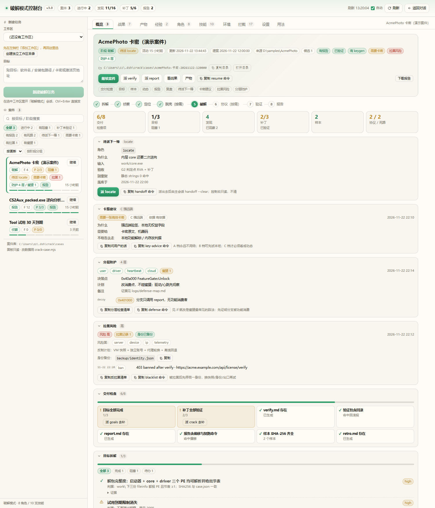
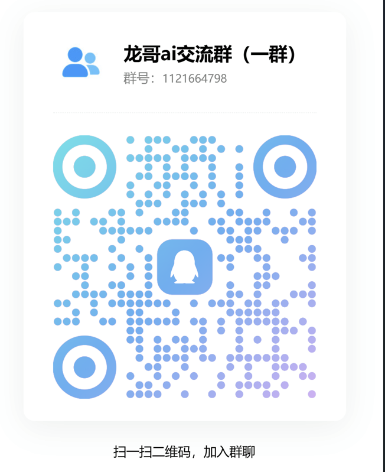

# LG破甲 · 破解模式 · Crack Mode

### 把逆向工程从「碰运气」变成「可交付」

**全自动流水线 · 少人盯屏 · 越用越聪明**

**不飘（不幻觉） · 不死循环 · 不炸机**

**v2.1.0 · 商业授权版 · 首发个人版 ¥299** · 本仓库只做展示，不包含源码 / 安装包

**VMP 壳 · 反调试 · 自动拉黑 · 云下发载荷 —— 硬骨头专供。**  
**手机 APK：拆包 / 动态 / 抓包 / 去证书固定 / 重打包签名。**  
**旁路模式：AI 指导破解助手，按上下文点对点回答。**

> 不是提示词，是一条会自己往下走的流水线。  
> 你给目标，它推进；关键点你拍板。

---

## 你买的不是一段分析

| 常见做法 | 破解模式 |
|---|---|
| 对话一断，进度归零 | 案件式管理，下次接着做 |
| 改完能不能用靠试 | 改前、改后、回滚，结果可验证 |
| 越改越糟，触发一堆检测 | 先判断再动手，识别陷阱与副作用 |
| 报告只有结论 | 证据、步骤、边界，能复盘 |
| 被风控/封禁才反应 | 动手前先做风险判断 |

**真正的门槛不是找到一个 `if`，而是知道哪个 `if` 不该动。**

---

## 你是否也卡在这些硬骨头上？

- 样本一打开就是 **VMP / Themida / Enigma**，脱壳脚本跑了一晚上，OEP 还是没影。
- 断点刚下，程序直接退出；换个调试器，还是被 **反调试** 识别。
- 补丁刚打上，账号 / 设备 / 授权直接被 **拉黑**，连测试机会都不给。

**这不是你不够努力，是保护链本来就这么设计的。**

**VMP 壳、反调试、自动拉黑——这套流程就是为它们准备的，能解。**

先把壳、反调试、风控拆成层，再找真正的决策点；能绕就绕，不能绕就换路线；改前先想好怎么退。

| 你卡在哪 | 它会怎么带你走 |
|---|---|
| VMP / 壳 | 先判壳与保护面，脱不了就换路线，不在一棵树上吊死 |
| 反调试 | 先找检测点与触发条件，能绕则绕，不能绕就换环境 / 时机，不硬碰 |
| 自动拉黑 | 动手前先做风险判断，身份 / 出口 / 账号分层隔离；命中即停，换一层继续 |
| 改完没效果 | 找真正决定功能的那一处，不跟诱饵分支较劲 |

---

## 云下发载荷：不是抓一次包就完事

样本只是个 loader，真正的载荷在云端：

- 今天下发的包，明天就换；
- 抓到的 URL，换台机器就复现不了；
- 断网就废，联网就被检测；
- 假服务器搭了，签名又对不上；
- 改完不知道对不对，只能再抓一次。

这套流程把「云下发」拆成六件可交付的东西：

| 你头疼的 | 它交付的 |
|---|---|
| 云端每次换包 | **抓工件**：载荷、配置、脚本、依赖完整落盘 |
| loader 一层套一层 | **loader 分析**：阶段入口、解密点、释放链 |
| 断网就废 | **离线化**：本地可复现，不靠云端 |
| 联网就被识别 | **假服务器 / proxy DLL**：把云端搬到本地 |
| 签名对不上 | **签名矩阵**：哪些字段被签名、哪些能改、哪些一改就上报 |
| 改完不知道对不对 | **验证表**：每个分支、每个结果、每次回滚都能对照 |

**从「抓到一次」到「能反复复现」，这才是云下发载荷的交付。**

---

## 手机 / APK：一条链打通

安卓逆向最烦的不是不会，是工具链太散：拆包、adb、frida-server、代理、证书、重打包、签名，每一步都能卡半天。

这套流程把手机端也串成一条链：

| 环节 | 能力 |
|---|---|
| APK 静态拆包 | jadx、apktool、smali 三种改法 |
| 手机动态调试 | adb + frida-server / objection |
| 抓包 | mitmproxy / mitmdump + 手机 Wi-Fi 代理 |
| 证书固定绕过 | objection、apk-mitm、Frida hook |
| 重打包 / 签名 | apktool + apksigner（v1 / v2 / v3） |
| 设备接入 | 真机 / 模拟器连接、代理、证书、frida-server 启动，流程里直接提示 |

**从「拆包」到「装回手机验证」，不是一堆散命令，是一条能收口的链。**

---

## 它能给你什么

- **少走弯路**：把目标拆成可验证的小步，不在一开始就硬刚最硬的那层。
- **可复现**：每个结论都有依据，每个改动都能回滚，换台机器也能重来。
- **可交接**：案件状态不靠对话记忆，隔天、换会话都能接上。
- **知道什么时候停**：什么时候该继续、什么时候该换路线、什么时候该向你要信息，有判断。
- **越用越顺**：同类目标的经验会沉淀下来，下一单不用从零开始。

---

## 全自动流水线：少盯屏，多拿结果

你只需要做三件事：

1. 把目标丢进来
2. 关键分叉点拍板（要不要继续 / 换不换路线 / 给不给信息）
3. 验收结果

中间的拆目标、判保护、选路线、跑验证、写报告，它自己往下推。  
**不需要你每一步都喊“下一步”；该问你的时候才问你。**

| 传统做法 | 全自动流水线 |
|---|---|
| 每一步都等你喊 | 自己往下走 |
| 守着终端几小时 | 关键点才找你 |
| 失败重来一遍 | 失败换路，记录留档 |
| 上下文断了重开 | 接着上一棒跑 |

**把“人一直操作”变成“人做关键决策”。**

---

## 四个让你敢用的理由

### 01 不飘，也不幻觉：不靠猜，靠证据

不是「看起来像」，而是「跑过、对过、能复现」。  
结论按证据强弱分级：跑过、对过、能复现的才算数；只靠推理的，只能算假设。  
**没有落盘的成果，不会写成结论。**

### 02 不死循环：每一步都有出口

目标拆阶段，失败有记录，走不通就换路线。  
不会在一个分支上反复打转；该停时停，该问时问，该换刀时换刀。  
**卡住不是重来一遍，而是带着「试过什么」换下一条路。**

### 03 不炸机：先隔离，再动手

样本默认只动工作副本，原件只读；危险命令先拦截；改前留快照，改后能回滚。  
遇到可疑分支，先判断它是不是陷阱；不确认就不改。  
**避免「一改就触发上报 / 自毁 / 格机 / 中招」这种最贵的错误。**

### 04 越用越聪明，自动进化：每次都留下经验

每个案件结束都复盘：什么有效、什么不通、缺什么工具。  
不是写死规则，而是每次结案自动进化；下一单自动带出同类坑，不用从零再踩一遍。  
**用得越久，越像带着一个做过同类案子的搭档。**

---

## 旁路模式：AI 指导破解助手

不是通用聊天，是贴着当前案件上下文，**点对点回答你的下一步**。  
它知道你卡在哪、试过什么、下一步该问什么。  
不用先学汇编，不用懂偏移，也不用写 prompt。  
像机器人一问一答，在任务旁边直接问：

- 「这个壳是什么？下一步先干嘛？」
- 「这个偏移能不能改？改完会怎样？」
- 「为什么刚才没打通？现在卡在哪？」
- 「我不想动二进制，有没有不下手的路？」

它实时按当前案件上下文回答：目标、阶段、已有发现、补丁、死路都在，不会从零开始瞎猜。  
**老手拿来随手确认，新手拿来当带教。** 不用懂底层，也能问出下一步。

---

## 谁需要它

- **被 VMP / Themida / Enigma 卡住的人**：壳一层套一层，想少走弯路。
- **被云下发 / 多阶段 loader 折磨的人**：抓到的包换台机器就废，想要能反复复现。
- **做 Android / APK 逆向的人**：拆包、动态、抓包、去证书固定、重打包签名，一条链。
- **被反调试折磨的人**：断点刚下就退出，想先看清检测面再动手。
- **被自动拉黑的人**：补丁刚上就被封，想改前先想好怎么退。
- **手上有一堆样本的人**：每次都从零分析，想要能复用、能交接的工作台。
- **刚入门的人**：不想先啃汇编，想有人把下一步翻译成人话。
- **做红队 / 安全研究 / CTF / 工作室的人**：需要一个能打硬仗、还能复盘的系统。
- **没时间一直盯屏幕的人**：给目标、拍板、验收；中间它自己跑。
- **只想要结果、不想把机器搭进去的人**：先隔离、先快照、能回滚。

---

## 界面

> 破解模式控制台 v3（示例数据）。

---

## 版本与价格

> 以下为展示模板，实际版本、价格、名额以 QQ 群置顶公告为准。

| 版本 | 适合 | 交付 | 价格 |
|---|---|---|---|
| **个人版** | 1 台机器 | 插件包 + 成套技能 + 控制台 + 1 年更新 | **¥299（首发）** |
| **团队版** | 2–5 台 | 个人版全部 + 远程部署 + 优先支持 | 面议（按台数） |
| **定制版** | 工作室/团队 | 私有技能、流程定制、接口对接 | 面议 |

**交付内容**

- 完整插件包 + 预设 + 成套技能库
- 整页控制台 + 案件模板 + 安装说明
- 1 年内版本更新
- QQ 群内安装/使用支持

不含模型 API 额度；模型/API 由你自己配置。

---

## 购买与进群

**首发个人版 ¥299** · 群内看完整演示

**QQ 群：1121664798（龙哥ai交流群 一群）**

> 扫码进群，群号 **1121664798**（龙哥ai交流群 一群）。

**购买流程**

1. 进群，先看置顶：版本 / 价格 / 演示 / 交付方式
2. 群内看完整演示，或约远程演示
3. 确认环境与版本，付款（群内指定）
4. 收插件包 + 安装说明，远程/群内协助安装验收

**为什么收费**

卖的不是一段 prompt，是一条能自己推进、能管理、能验证、能交接的流水线，以及后续的更新和群内支持。逆向工程的时间花在判断、验证和边界上，这套东西就是把这些环节固化下来。

---

## FAQ

**Q：首发价多少？**  
个人版 **¥299**（首发）；团队版、定制版以群公告为准。

**Q：开源吗？**  
不开源。本仓库只放展示和截图；源码、技能包、安装包只在群内交付。

**Q：有试用吗？**  
群内看完整演示，或约远程演示；试用政策以群公告为准。

**Q：需要什么环境？**  
Windows 10/11 x64 + 已安装 DSH；模型/API 自备。插件本身不含模型额度。

**Q：VMP / 反调试 / 拉黑能搞吗？**  
能搞。这套流程就是为它们准备的：先判层，再找决策点；能绕就绕，不能绕就换路线，不在一棵树上吊死。

**Q：云下发载荷能搞吗？**  
能。抓工件、loader 分析、离线化、假服务器 / proxy DLL、签名矩阵、验证表，一条链交付。

**Q：手机 APK 能搞吗？**  
能。静态拆包、动态调试、抓包、证书固定绕过、重打包 / 签名，一条链打通。

**Q：新手能用吗？**  
能。旁路模式是 AI 指导破解助手：贴着当前案件上下文，点对点回答你的下一步；不用懂汇编，直接把「下一步干嘛」问出来。

**Q：需要一直盯着吗？**  
不用。给目标、关键点拍板、验收结果；中间它自己跑。

**Q：能保证什么？**  
保证每一步有证据、每个改动能回滚、每次失败有记录；不靠运气，也不靠猜。

**Q：更新和支持呢？**  
1 年内免费更新；安装、使用、案件流程在群内支持。

**Q：能转售/二次分发吗？**  
不能。授权仅限购买者本人/本团队使用，禁止转售、二次分发、拆包售卖。

**Q：和网上的提示词有什么区别？**  
提示词给你一段话；这套东西给你一套能管理、能验证、能交接的流程。

---

## 仓库说明

- 本仓库**只放展示材料**：`README.md` + `docs/` 截图，不含源码、技能包、安装包、Release。
- 购买、演示、更新、安装支持：**QQ 群 `1121664798`**。
- 未经授权，禁止复制、转售、二次分发本产品及本仓库文案/截图。
- 仅面向对目标软件有合法分析授权的用户；不提供代破解、代运营服务。

---

## 搜索关键词

**LG破甲 · 破甲 · 深度求索 · 人工智能安全评估 · 技能库 · 漏洞知识库**

破解模式 · Crack Mode · DSH 插件 · DeepSeek · AI 逆向 · 逆向工程 · 恶意样本分析 · APK 逆向 · 手机逆向 · VMP 脱壳 · 反调试 · 云下发载荷 · 抓包 · 证书固定绕过 · 重打包签名 · Frida · Ghidra · 安全评估

---

**为愿意读证据的人准备。**

`v2.1.0` · DSH plugin

[加入 QQ 群](#buy)

---

## GitHub 仓库信息（可直接填）

**Description**

> LG破甲 / 破甲 / 深度求索 / DSH 破解模式（商业授权版）：全自动流水线，少人盯屏；VMP 壳 / 反调试 / 自动拉黑 / 云下发载荷 / 手机 APK 全链路；不飘、不幻觉、不死循环、不炸机；旁路 AI 指导，按上下文点对点回答。人工智能安全评估 / 技能库 / 漏洞知识库。首发 ¥299，QQ 群 1121664798。本仓库仅展示，不含源码。

**Description (EN)**

> LG Crack / DSH Crack Mode (commercial license): an automated pipeline that cuts hands-on babysitting; built for VMP shells, anti-debug, auto-blacklist, cloud-delivered payloads and mobile APKs; evidence-first, loop-safe, isolation-first, with a beginner-friendly side-channel Q&A. AI security assessment, skill library, vulnerability knowledge base. Showcase only — source not included.

**Topics**

`dsh` `reverse-engineering` `crack-mode` `lg-crack` `lg-pojia` `ai-security` `security-assessment` `malware-analysis` `frida` `ghidra` `apk-reverse-engineering` `vmp` `anti-debug` `cloud-payload` `skill-library` `vulnerability-knowledge-base` `deepseek` `windows` `commercial-software` `security-tools`

**Short pitch（群/动态用）**

> LG破甲 / 破甲：全自动流水线，少人盯屏；VMP 壳、反调试、自动拉黑、云下发载荷、手机 APK 硬骨头专供；不飘、不幻觉、不死循环、不炸机；旁路 AI 指导破解助手，按上下文点对点回答。首发个人版 ¥299。  
> GitHub 只展示，完整版在 QQ 群：`1121664798`。
