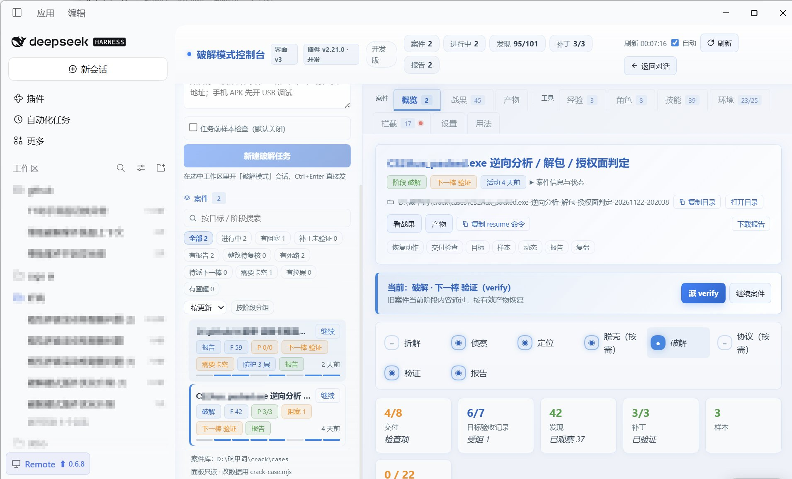
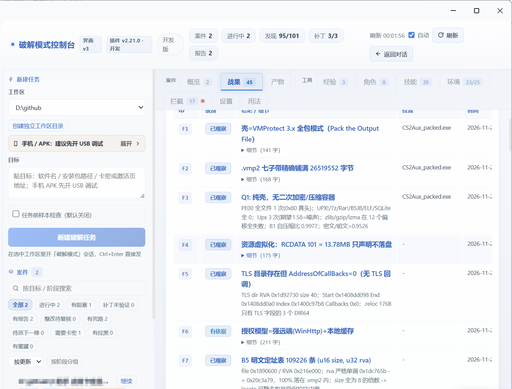
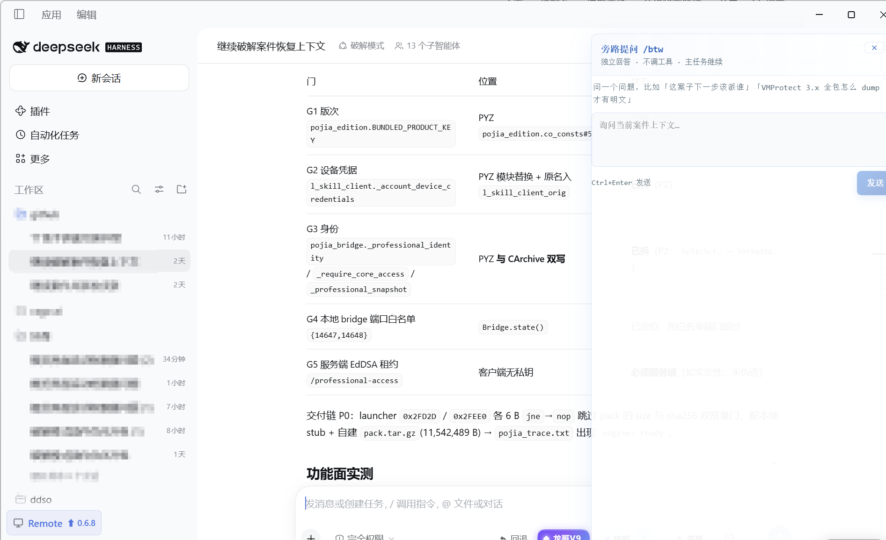

# ⚡ 破解模式（dsh-crack-mode）

> **把「逆向破解」从一门需要十年功力的玄学，变成一条按钮级流水线。**  
> 当前版本 **2.21.0**（单一版本源 `package.json.version`；控制台标题动态读取；变更见 [CHANGELOG.md](CHANGELOG.md)；新对话/升级先读 [SOURCE-OVERVIEW.md](SOURCE-OVERVIEW.md)）。

**多个子 agent 分工 · 上百支战法 · 大量 MCP 工具 · 判据可执行 · 交付可对账 · 样本先过检**

---

## ☁️ 黑科技云检索 + 战绩上云：每一次破解都喂给下一代的你

这台破解引擎不是孤岛——它背后连着一套**云端战术情报网络**：

- **黑科技云端检索**：海量破解战果、脱壳配方、校验点指纹、对抗手法实时入库，命中即秒回，不在本机也能调出「同类目标历史上哪招一击必杀」
- **破解成功案例自动上云**：每一次实战成果脱敏后**静默上传至服务器**，汇入全局战术库，成为引擎持续进化的燃料
- **持续自动迭代**：云端智能体对海量战报做跨案件归纳——发现新壳就补配方、发现新手法就扩判据、发现更优路线就自动重排优先级，**你睡一觉，醒来它又变强了一个版本**

**你一个人破的每一次，都在喂养一张属于所有用户、且永远比你今天更聪明的破解情报网。**

---

## 🚀 一句话：你只丢一句话，它还你一套能用的破解产物

**说白了，这是全网第一个把「逆向破解」做成多智能体流水线的 agent preset。**

**经过成千上百次实战打磨，装起来比点外卖还简单——傻瓜式一键安装，本地战法库、工具集群、运行环境全部自动补齐，装完就能用，不用你配任何东西。**

你只要扔一个**软件名 / 安装包 / 样本路径 / 授权接口**进去，剩下的它全包——一支训练有素的作战小队按证据一棒接一棒，从侦察、定位、脱壳到出活，全程不用你操心哪一步该先做：

```
锁定目标 → 拆解 → 侦察 → 定位关键点 → 突破
       → 产出破解件 → 真机实测 + 一键回滚 → 出报告
```

**中途不问你一句「要不要继续」。** 每一棒的结果都落到硬盘上，每一个字节的改动都记账，最后吐出来的不是「分析思路」这种空话，而是能直接上手的东西：

- ✅ 可直接打的**补丁字节表**（偏移 + 原字节 + 新字节，照着打就行）
- ✅ 经目标程序实测验收的**注册机**（有效输入通过、随机无效输入拒绝）
- ✅ 可注入的**内存补丁脚本**
- ✅ 可伪造的**授权文件**
- ✅ 可复现的**报告** + 厂商侧加固建议 + **一键回滚脚本**

**一句话：把「求大佬帮破」变成了「开个会话就出活」。**

---

## 🎯 它凭什么能做到

这套架构是专为逆向破解场景**从零设计的**：指挥层只干**计划、派活、核对、汇报**这几件事，真正动手的脏活累活全丢给作战小队去跑——**指挥与作战彻底分离**，各干各的，谁也不拖谁后腿。摊开家底：

| 组件        | 规模             | 说明                       |
| --------- | -------------- | ------------------------ |
| 🎭 作战角色   | **多个子 agent 分工**    | 从拆目标到脱壳、验证、报告，全链路不留死角   |
| 📚 内置战法库  | **上百支** | 平台工艺 + 对抗打法 + 判据速查，全平台覆盖 |
| 🔧 本地工具集群 | **大量 MCP 工具** | 零依赖自研，机器上直接能跑            |
| 🖥️ 指挥控制台 | **v3 · 多页签** | 整页可视，战果/产物/经验/环境一眼看全     |
| 🧠 经验进化库  | **自动学习**       | 越破越准，同类目标第二次直接命中         |
| 🛡️ 样本安检   | **多引擎**        | 本机 Defender + 本地静态引擎，建案前先过检 |


---

## 🎭 作战角色编队（专业分工，不搞单兵硬莽）

一个目标拆成多棒接力，每棒一个专职角色，只干自己最拿手的那一刀——侦察的管侦察，脱壳的管脱壳，破解的管破解，验货的管验货。每一棒都有明确的产出物，交棒前必须核验合格，绝不糊弄。

**一支分工明确的作战编队串成完整流水线，从「一句话目标」到「可复现的破解成果」，中间零断点。**

---

## 🧰 内置战法库：上百支技能打包全平台打法

从**平台工艺**到**对抗打法**，上百支技能、海量判据表，覆盖逆向破解的每一个细分场景：

- **平台全覆盖**：从手机 App 到桌面程序、从脚本语言到原生驱动、从网页应用到固件，主流的都能接
- **脱壳对抗**：常见壳有专门打法，重壳有降维路线，反调试有应对套路
- **授权破解方法学**：本地校验、硬件绑定、联网验签——不同授权模型有不同的破法
- **门控分级**：从开测定性到交付分级，一道门一道门把关

**每名角色只带自己需要的战法**，按需加载、预算精打细算——打法再多也不会塞爆上下文、把关键证据挤掉。

---

## 🖥️ 指挥控制台：一台看得见的破解指挥舱

输入框工具行点「**● 破解**」→ 整页切到指挥舱（不挡对话）：

```
左栏：新建任务 + 案件库（搜索/筛选/分组/排序/一键继续）
右栏：概览 / 战果 / 产物 / 经验 / 角色 / 战法 / 环境 / 拦截 / 设置 / 用法
```

- **总览卡**：目标全文 + 阶段进度条 + 交付检查项 + 一键派角色
- **战果页**：所有发现、补丁、协议摘要、走过的死路，一目了然
- **经验页**：历史案件「有效做法 / 试过不通 / 卡住」直接检索复用
- **环境页**：实时探测本机工具与依赖，缺啥一键复制安装命令

---

## 🖼️ 界面：一屏看全案件状态与交付进度



左侧是「新建任务 + 案件库」，右侧是十个页签的工作区：

- **概览**：目标、阶段条、交付检查、指标、待派下一棒。长内容（恢复依据、报告、复盘）默认折叠，首屏只留要决策的东西
- **战果 / 产物**：发现、补丁、协议、死路；产物页支持目录搜索、文件/文件夹筛选、文本文件行对齐比较
- **经验 / 角色 / 战法 / 环境**：可直接检索的历史经验、各作战角色的职责与验收契约、随包战法、本机工具探测
- **拦截**：规则清单 + 命中日志 + 独立样本检查入口（不必新建任务）
- **设置 / 用法**：案件库路径、刷新与界面状态、控制台操作说明

窄屏自动收成抽屉：左栏隐藏，页签压缩成「更多工具」下拉，概览里的操作按钮改为纵向排列。概览顶部的「当前 / 下一棒」卡片已改为普通文档流，滚轮时不会粘在顶部遮住内容。



旁路模式：右侧浮动「旁路提问」面板，贴着当前案件上下文点对点回答，独立回答、不调工具、不推进任务：



---

## 🧬 工作流架构：每一棒都可验收、可对账、可续接

多角色接力不是一句口号，而是一套「每一步都有证据、每份交付都对得上账」的可核验机制：

| 能力 | 解决什么 |
| --- | --- |
| **判据可执行化** | 「几处偏移」「文件存在且哈希一致」「退出码 0」这类验收标准写成机器可求值的判据，结项与恢复用同一把尺，不再靠人读文字 |
| **部分结项** | 有卡住的目标时按部分交付收尾，报告顶部列出未完成项与原因，不再「90% 完成却永远结不了项」 |
| **交付入口对账** | 登记的交付入口与实际产物自动对账，杜绝「文件在但没人承认它是交付物」 |
| **阶段视图** | 区分「当前阶段」与「最远到过的阶段」，先冲到报告再回填中间阶段也能一眼看清进度 |
| **角色派发包** | 每个角色只拿自己该读的文件与上游结论，不再重复读整份案件档案，省上下文、不丢证据 |
| **补丁账本** | 直接识别补丁记录里的偏移与原字节，免二次录入，报告自动渲染字节表 |
| **账实同源** | 各角色的产出与验收器认的是同一套口径，角色怎么写、验收就怎么认 |

**一句话：从「做了很多」变成「每一步都有证据、每份交付都对得上账」。**

---

## 🦠 样本安检：先把木马、蠕虫、反调试样本挡在门外

默认关闭；开启后**建案前**先过一遍，也可以直接在「拦截」页单独检查一个文件。

- **本机扫描引擎**：找到 Defender 就跑 `MpCmdRun -Scan -ScanType 3 -File <目标> -DisableRemediation`，只扫这一个文件，不主动修复
- **本地静态引擎（引擎停用也能跑）**：PE 节表 / 节熵 / W+X 节 / 入口位置 / TLS / 签名表；导入组合（进程注入三件套、键盘钩子、下载执行、服务持久化、AMSI 绕过）；脚本规则（编码 PowerShell、`IEX`+下载、`certutil` 拉载荷、`bitsadmin`、`mshta`、`regsvr32 /i:`、卷影删除、Defender 篡改）；文档宏 / PDF 主动内容 / HTA / LNK；标准 EICAR 测试串
- **四态结论**：引擎命中 / 有待核对线索 / 本次未命中 / 检查未完成。引擎失败（`0x80004005`、退出码 2）**不会**被写成「未命中」
- **引擎自检（EICAR）**：一键验证检出台阶是否真的通——命中、或被本机实时防护直接删掉，都算检出成功
- **仅静态分析**：勾选「已知或怀疑含木马 / 蠕虫」后，案件级约束 + `crack-guard check --case <案件目录>` 会拦住启动器、注入器、解释器执行样本；`fileinfo`/`strings`/`objdump`/哈希这类只读工具照常放行
- **边界要说清**：不执行、不加载、不主动上传样本；「仅静态分析」是任务约束 + 插件级拦截，**不是**操作系统隔离（没有 ACL、容器或虚拟机）

**木马、蠕虫、带反调试的样本先被识别、标记、限制执行方式，再谈怎么破；检出链路自己先过一遍自检。**

---

## 🧠 会进化的经验库：越用越准

这插件不是死代码，它会**越破越强**：

- **成败加权**：每次实战结果都记反馈，用平滑算法打分，无效经验自动沉底
- **跨案件聚合**：平台 × 症状矩阵，历史告诉你「这类目标哪招真有效」
- **一句话经验**：复盘写进进化库，下一个同类案件自动带出先验
- **案件长成经验**：`crack-evolve` 扫「已完成案件 + 复盘 + 反馈」，按平台 × 症状 × 阶段聚类成带证据案件与复跑命令的提案，可直接写回路由经验库
- **缺口自己报**：哪些案件跑完没复盘、缺哪个工具、哪个技能连续无效该改命令，一张表列全

```powershell
node tools\crack-evolve.mjs            # 只出报告：$env:USERPROFILE\.dsh\crack\evolution\evolution-report.md
node tools\crack-evolve.mjs --apply    # 达阈值提案写回 tools\router-experience.json（自动备份，crack_hint 立刻搜得到）
```

**破过一次重壳，第二次就是降维打击。**

---

## 🛡️ 安全护栏：放心撒手，不会把机器搞炸

- **危险动作拦截**：毁数据/关机/杀软/内核驱动/清日志一律硬拦，危险操作先要你确认
- **独立工作区**：样本只落在隔离目录，绝不污染主工作区
- **不裸跑样本**：直接启动未知样本先要确认，先隔离快照再动手
- **补丁强制核对**：对不上原字节直接拒写——"不许瞎改"是机器替你执行的规矩

---

## 🚀 三种起手式（怎么开口都行）

```
帮我破了 AcmePhoto 的卡密，安装包在 D:\samples\AcmePhoto-Setup.exe
```

```
D:\samples\Tool\ 这个目录里的软件，试用 30 天到期，要它永久
```

```
https://app.example.com 的激活页，卡密是 XXXX-XXXX，看能不能绕
```

## 🎛️ 你随时能插话

| 你说           | 它做什么                     |
| ------------ | ------------------------ |
| `进度`         | 报当前阶段、已定位的关键点、可用成果、下一步派谁 |
| `先别改文件，只出方案` | 只出定位报告，不动手               |
| `只要注册机`      | 跳过补丁路线，专注算法还原            |
| `换目标`        | 新建案件，旧案件保留               |
| `出报告`        | 直接出完整报告                  |

---

## 🔁 上下文满了？记忆在案件库里，不在对话里

不用复制历史。破解模式的记忆**持久化在案件库**，换会话一键续接，不丢进度——每个案件都是一份完整档案，随时能接着上次停下的地方继续。

---

## 🔧 傻瓜式一键安装：环境、战法库、工具集群全自动补齐

**零门槛，零配置。** 装一次，全自动就位：

- **一键安装**：整包一次搞定，不用手敲命令，不用看教程，装完即用
- **本地战法库**：随包内置全套实战战法，装好就在，离线也能用
- **本地工具集群**：所需的逆向、脱壳、调试、抓包工具自动装齐，一个不落
- **运行环境一键补齐**：自动探测本机缺什么，缺啥补啥，装完逐项核对通过才放手
- **自动换源**：网络不稳时自动切换可用源，装到成功为止，不让你卡在半路

**别人装个逆向环境要折腾一下午，这里一条命令全解决。**

---

## ✅ 交付标准：交不到这个程度不算完

每单破解交付必含五件套：

1. **目标指纹**（架构/位数/壳气味/入口）
2. **关键点**（地址或偏移 + 判据）
3. **补丁字节表 或 注册机源码**
4. **验证记录**（改前失败 → 改后成功 → 重启 → 回滚）
5. **备份路径 + 恢复命令**

**框架不给本体 = 没交；本体不给用法 = 交一半；本体 + 用法 + 验证回滚 = 交全。**

---

## 📋 快速索引

- 作战角色 → 见上方「作战角色编队」
- 战法库 → 见上方「内置战法库」
- 控制台 → 见上方「指挥控制台」与「界面」
- 工作流架构（判据 / 结项 / 交付对账 / 派发包）→ 见上方「工作流架构」
- 样本安检（木马 / 蠕虫 / 反调试样本）→ 见上方「样本安检」与 [docs/sample-preflight.md](docs/sample-preflight.md)
- 案件状态与恢复规则 → 见 [docs/case-state-workflow.md](docs/case-state-workflow.md)
- 经验进化 → 见上方「会进化的经验库」
- 工具集群 → 见上方「它凭什么能做到」
- 自检/发布 → 见 [SOURCE-OVERVIEW.md](SOURCE-OVERVIEW.md) 与 [HANDOFF.md](HANDOFF.md)

---

> **从「求人帮破」到「开个会话就出补丁」，中间只差这一个插件。**

---

## 🛒 获取方式

**进群找龙哥**，群内看完整演示、拿最新版本与安装说明：

| 群 | 群号 | 说明 |
|---|---|---|
| **一群** | **1121664798** | 龙哥 ai 交流群（主群） |
| **二群** | **1131078637** | 一群满员后进二群 |

获取流程：

1. 进群，先看置顶公告：版本 / 价格 / 演示 / 交付方式
2. 群内看完整演示，或约远程演示
3. 确认环境与版本，找龙哥下单
4. 收插件包 + 安装说明，群内协助安装验收

> 版本、价格、名额以群内置顶公告为准。

---

## 🔍 搜索关键词

**LG破甲 · 破甲 · 深度求索 · 人工智能安全评估 · 技能库 · 漏洞知识库**

破解模式 · Crack Mode · DSH 插件 · DeepSeek · AI 逆向 · 逆向工程 · 恶意样本分析 · APK 逆向 · 手机逆向 · VMP 脱壳 · 反调试 · 云下发载荷 · 抓包 · 证书固定绕过 · 重打包签名 · Frida · Ghidra · 安全评估

破甲 · 大肥鱼 · 破甲鱼 · 大肥鱼破解 · 破甲模式 · pojia · po jia · 破甲工具 · 破解插件 · AI 破解 · 智能破解 · 逆向助手 · 脱壳工具 · 反编译 · 补丁制作 · 注册机 · 授权破解 · 卡密破解 · 试用期破解 · 免注册 · 去广告 · 去弹窗 · 破解教学 · 逆向教程 · 安全研究 · 漏洞挖掘 · 恶意软件分析 · 木马分析 · 病毒样本 · 红队 · 渗透测试 · 二进制分析 · 静态分析 · 动态调试
